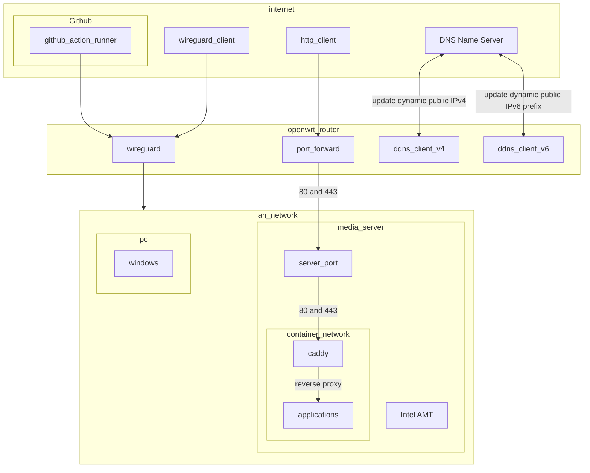
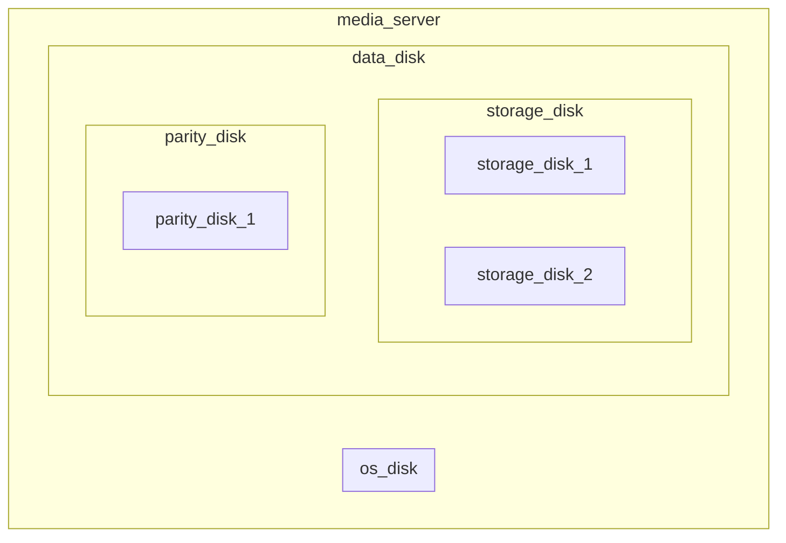

# Selfhost Server

[](https://github.com/zephyros-dev/media-server/actions/workflows/deployment.yaml)

Code for running self-hosted services using podman and pyinfra

Want to know more about selfhosting a media server? [Checkout the docs](docs/README.md)

## Infrastructure graph

### Networking



#### Data



## Deployment

pyinfra (`deploy/`) does the deployment. The mise tasks load the deployment ssh key themselves, and extra arguments go to pyinfra

```bash
# Server: host setup and every app
mise run deploy
# Preview the changes first
mise run deploy --dry
# Some apps only, without the host setup
mise run deploy --data apps=nextcloud,caddy
# Host setup only, without the apps
mise run deploy --data host_only=true
```

Staging runs on the server as a libvirt VM (`tofu/staging`). `deploy-staging` starts it, waits for it to boot, then deploys to it the same way

```bash
mise run deploy-staging
mise run deploy-staging --dry
mise run deploy-staging --data apps=nextcloud
# Shut the VM down
mise run deploy-staging stop
# Rebuild it from scratch (the data disks are kept)
cd tofu/staging && tofu apply -replace=libvirt_volume.staging_root -replace=libvirt_domain.this
```

## Note

- Always run the partition deploy with --dry first

  ```bash
  uv run pyinfra deploy/inventory.py deploy/partition.py --limit server --dry
  ```

### PC

#### Mounting server into PC with libvirt

- My server hardware failed recently due to a botched bios upgrade from fwupd, so I had to migrate the server to my current PC for temporary usage. Luckily qemu came to the rescue, and setting it to boot all the disks was possible. I did not write the code to setup the qemu machine since it's only a temporary solution until I build a new NAS, so I figure I'll write some tips here for my future self for reference should this ever happened again
  1. Setup qemu for Linux machine
     - On bazzite I just use `ujust setup-virtualization`
       - Enable Virtualization
       - Add `user` to libvirt group
       - Install the virt-manager as user Flatpak
       - Enable VFIO drivers
  2. Setup bridge interface for machine (with `eno1` being the network interface)
     - `nmcli con down eno1`
     - `nmcli con delete eno1`
     - `nmcli con add type bridge ifname br0`
     - `nmcli con add type bridge-slave ifname eno1 master br0`
  3. Setup machine on virt-manager
     - Manual Install
     - Coreos (or whatever linux flavor)
     - Memory + CPUS
     - Untick `Enable storage for this virtual machine`
     - Tick `Customize configuration before install`
       - NIC
         - Network Source: Bridge device
         - Device name: `br0`
         - MAC Address: Use old mac address server so it can work with static router DHCP
       - Add these PCI host device
         - The OS SSD
         - The Motherboard SATA Controller (AHCI)
           - This is needed so that the disks are passthrough into the VM, the same as the previous server
       - Autostart the machine by the command (virt-manager option on the UI doesn't help for some reason)
         - `sudo virsh autostart <machine-name>`

#### Intel AMT support

- It's possible to control the PC remotely from BIOS via Intel AMT
- Setup:

1. Enable Intel AMT
2. Enable the integrated GPU in the BIOS in case of using a discrete GPU (NVIDA, AMD)
3. Set the integrated GPU as the default GPU in the BIOS
4. Use [Intel software](https://software.intel.com/sites/manageability/AMT_Implementation_and_Reference_Guide/default.htm?turl=WordDocuments%2Ftoolsusingkvm.htm) for setting up KVM (remote mouse and keyboard) to the PC. For cross-platform open source solution, checkout [Meshcentral in a container](https://github.com/Typhonragewind/meshcentral-docker)

#### Boot from Nvme

- I used a HPZ230 for the server with an NVME hard drive in the PCIE slot.
- The mainboard does not allow booting from PCIE slot directly, so I have to boot from [Cloverboot](https://github.com/CloverHackyColor/CloverBootloader) installed in an USB.
  - It can be installed by downloading the release from the github page and burn the ISO to the USB. The name is `CloverISO-<revision>.tar.lzma`
  - After burning the ISO into USB, copy the EFI\CLOVER\drivers\off\NvmExpressDxe.efi to EFI\CLOVER\drivers\UEFI
  - In the BIOS, set the boot order to boot from USB first
  - Then set the following settings in the BIOS
    - Advanced -> Option ROM Launch Policy -> Storage Options Rom -> UEFI only

#### WOL

- In the BIOS, enable wol via Advanced -> Device Options -> S5 Wake on LAN

#### OS

#### Ucore (rpm-ostree variants)

<https://github.com/ublue-os/ucore>

#### Services

##### Koreader connection to opds Calibre content server

- The koreader opds requires `/opds` path to the calibre content server
- The calibre content server authentication need to be `digest` for the koreader opds

## Maintenance notes

### Postgres major version update

- To upgrade postgres major version, do the following, deploying the app with `mise run deploy --data apps=<app>` at each step
  1. Change the `postgres_action` key in variable files to `export` and deploy the app
  2. Change the image tag to the next major version (if coming from version below 18, also change `DATA_MOUNT` in deploy/tasks/application/postgres.py and the container mountPath in cue file)
  3. Change the `postgres_action` key in variable files to `import` and deploy the app
  4. Change the `postgres_action` key in variable files to `none` and deploy the app
  5. Check if the container startup correctly
  6. Change the `postgres_action` key in variable files to `clean` and deploy the app to clean up the previous backup
  7. Change the `postgres_action` key back to `none` and deploy the app again: with any other action the pod only runs its postgres container

#### Restic restores

1. Source the secret files to current shell

   ```bash
   ## Fish shell
   . (sed 's/^/export /' /etc/restic/restic.env | psub)
   ```

2. Get list of snapshots

   ```bash
   restic snapshots
   ```

3. Restore the files (remove the --dry-run once satisfied)

   ```bash
   restic restore -v <snapshot-id> --target / --include <absolute-path-to-restore> -v --dry-run
   ```

## Troubleshooting

### Kavita

#### Kavita failed to save progress

- Consult [this](https://wiki.kavitareader.com/en/faq##q-im-seeing-database-is-locked-errors-in-my-logs)

#### Nextcloud

##### Stuck in maintenance mode

1. Rebuild nextcloud

   ```bash
   mise run deploy --data apps=nextcloud
   ```

###### Debug postgres

1. Run the following command to enable adminer container for accessing postgres database

   ```bash
   mise run deploy --data apps=nextcloud --data debug=true
   ```

#### Container name with pod exists

- Check if the container exists as external storage in podman then remove that container

  ```bash
  podman ps --external
  ```

- Reference
  - <https://docs.podman.io/en/latest/markdown/podman-ps.1.html##external>
  - <https://github.com/containers/podman/issues/3983>

#### Pymedusa

##### Pymedusa failed create hardlink

- When pymedusa renames a show with hardlinks, it first creates the folder on the mergerfs pool. mergerfs creates it on the disks with the most common branch and most free space, so if an empty copy of that branch exists on every disk, the folder can land on another disk than the file. The hardlink can't be kept, and the file is silently moved to that disk instead
- To avoid this, remove the empty folders on every data disk, so the branch only exists on the disk that holds the file. In the video folder of each data disk (`global_disks_storage_path/<disk>/global_storage_video_path`), remove them until none is listed (removing a folder can leave its parent empty):

  ```bash
  fd --type empty
  fd --type empty --exec rm -r
  ```

###### Check failed to hardlink file

- Run this command in the Video folder

  ```bash
  find . -type f -links 1 ! -name "*.srt" -print
  ```

<!-- TODO: Write a scheduled monitoring for this -->

#### Reinstallation note

- If the server is reinstalled, some steps need to be taken:

  - Podman: Reset podman for rootless user

  ```bash
  podman system reset
  ```

- Renovate can be visisted at: <https://developer.mend.io>
